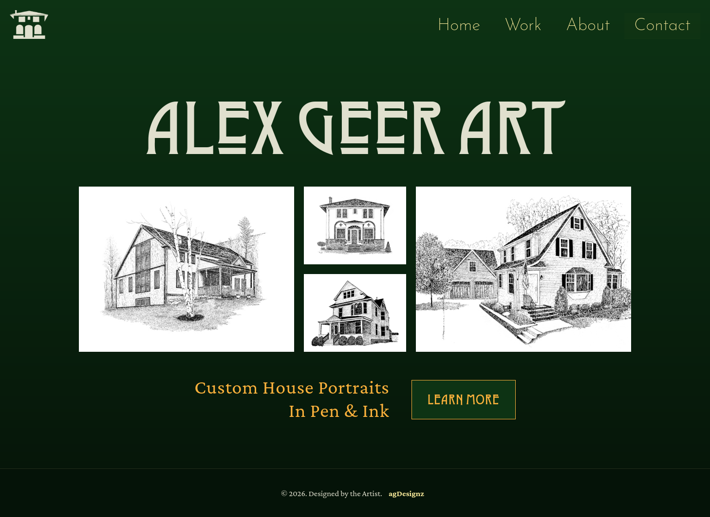

# AG Art Wordpress Theme

A modern block theme for my artwork.

(In progress)

## Overview

A custom block theme, coded from scratch, using modern Wordpress block architecture, including JSX, PHP and Scss. The site showcases my house-portraits side business, which grew out of my former job as a house painter.

The site replaces my original house portraits website, built while I was just learning web dev, using vanilla css, js, hard-coded HTML and Bootstrap. This new site uses Wordpress's CMS structure for easily adding content without having to rewrite code. It also reflects several years' experience building custom Wordpress sites.

#### [Check Out My Developer Website](https://alexgeer.dev)

---

## License

[GNU General Public License version 3 (GPL v3)](https://creativecommons.org/licenses/by-nc/4.0/)

---

_Built by [Alex Geer Web Design](https://alexgeer.dev)_
